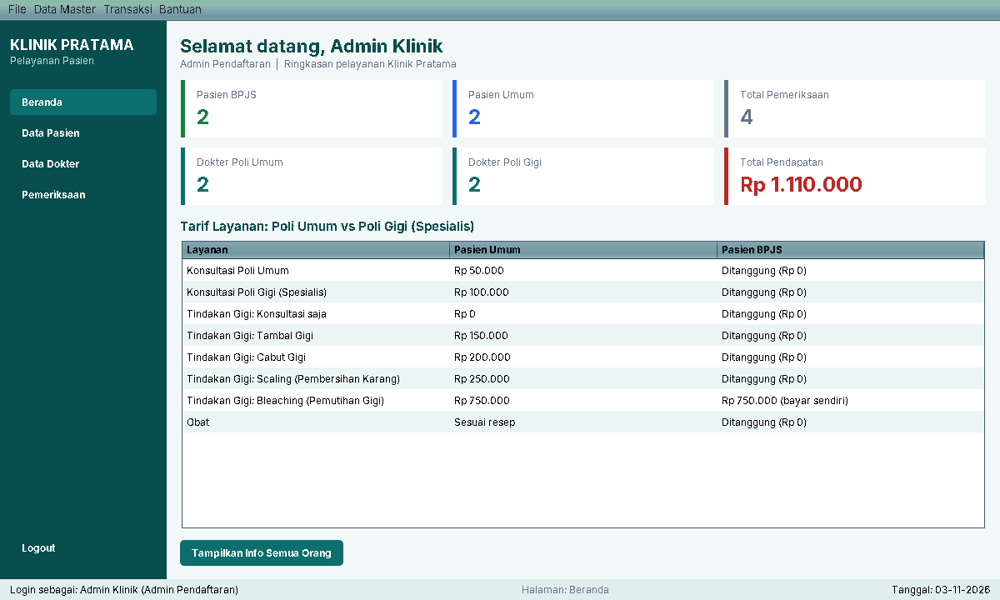
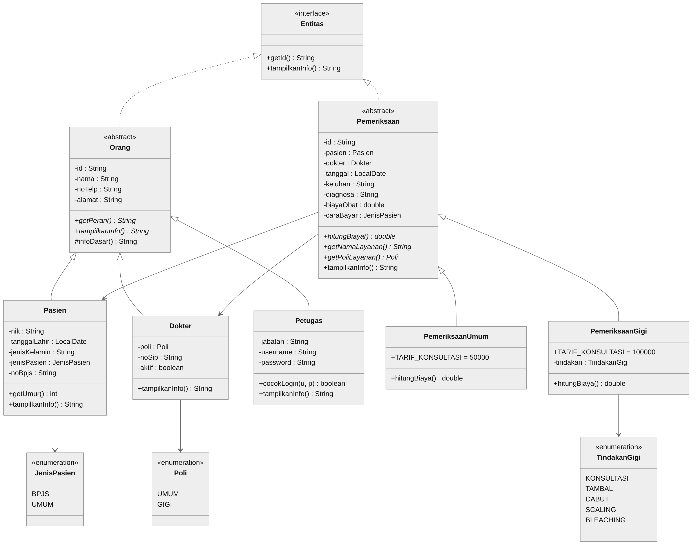
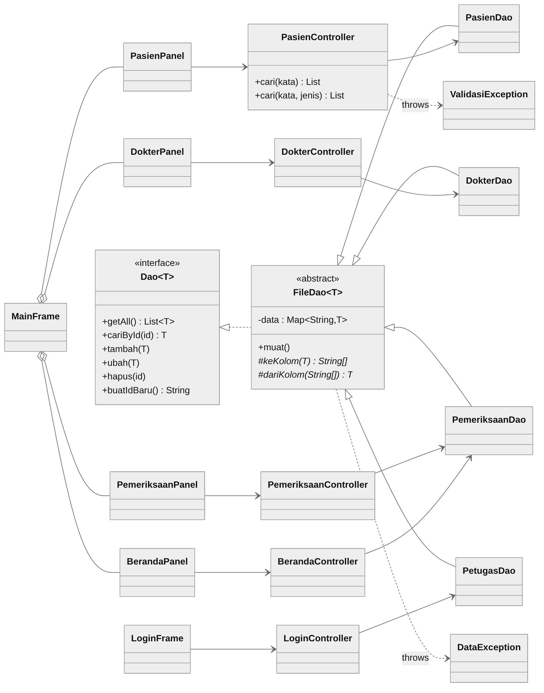

# Klinik Pratama: Sistem Informasi Pelayanan Pasien

Aplikasi desktop **Java Swing** untuk Tugas Proyek Pemrograman Berorientasi Objek (Implementasi GUI) 2026, tema **Klinik Pratama**.
Aplikasi menerapkan 4 pilar OOP, pola **MVC + DAO**, dan menyimpan data secara permanen di file teks.



## Kelompok

| No | Nama | NIM | Bagian |
|---|---|---|---|
| 1 | Handoyo | 21120124120040 | Desain kelas, model, exception, DAO, controller, tampilan Swing, pengujian |
| 2 | Thufail Bima Putra Raditya | 21120124130049 | *(dalam pengerjaan)* |
| 3 | Mikail Hikam Altiyar | 21120124130102 | *(dalam pengerjaan)* |

## Fitur

| Fitur | Keterangan |
|---|---|
| Login petugas | Akun awal `admin` / `admin123` |
| CRUD Pasien | Pasien **BPJS** (wajib No. BPJS 13 digit) dan **Umum**; validasi NIK 16 digit, NIK tidak boleh kembar |
| CRUD Dokter | Dokter **Poli Umum** dan **Poli Gigi (spesialis)**, status aktif/nonaktif praktik |
| CRUD Pemeriksaan | Pilih pasien, layanan, dokter, tindakan gigi; biaya dihitung otomatis |
| Hitung biaya (polimorfisme) | `hitungBiaya()` berbeda untuk Poli Umum vs Poli Gigi, dan BPJS vs Umum |
| Info (polimorfisme) | `tampilkanInfo()` berbeda untuk Pasien, Dokter, Petugas; struk pemeriksaan |
| Pencarian & filter | Semua tabel bisa dicari langsung saat mengetik dan difilter |
| Validasi | Pesan kesalahan yang jelas + konfirmasi sebelum hapus |

## Kebutuhan

- JDK 17 atau lebih baru (diuji dengan JDK 21)
- Visual Studio Code + ekstensi **Extension Pack for Java** (atau Eclipse / IntelliJ)

## Menjalankan

**Lewat VS Code:** buka folder proyek, tunggu ekstensi Java selesai memuat, lalu tekan `F5` dan pilih **Jalankan Aplikasi Klinik**.
Konfigurasi **Uji Konsol (tanpa GUI)** menjalankan pengujian model, DAO, dan controller.

**Lewat terminal** (dari folder proyek):

```bash
javac -encoding UTF-8 --release 17 -d out -sourcepath src src/klinik/App.java src/klinik/UjiKonsol.java
java -cp out klinik.App          # aplikasi
java -cp out klinik.UjiKonsol    # uji konsol
```

**Membuat file JAR:**

```bash
jar --create --file dist/KlinikPratama.jar --main-class klinik.App -C out .
java -jar dist/KlinikPratama.jar
```

**Membuat aplikasi desktop Windows (`KlinikPratama.exe`, Java sudah dibundel):**

```bash
jpackage --type app-image --name KlinikPratama --app-version 1.0.0 --icon packaging/klinik.ico --input dist --main-jar KlinikPratama.jar --main-class klinik.App --java-options "-Dklinik.mode=terpasang" --add-modules java.desktop --dest build/aplikasi
```

Hasilnya ada di `build/aplikasi/KlinikPratama/KlinikPratama.exe`. Hapus folder `build` terlebih dahulu jika ingin membuat ulang.

| Cara membuka | Lokasi data |
|---|---|
| `KlinikPratama.exe` (aplikasi desktop) | `%APPDATA%\KlinikPratama\data` |
| `java -jar dist/KlinikPratama.jar` | folder `data` di tempat perintah dijalankan |
| VS Code / terminal | folder `data` di proyek |

Lokasi data yang sedang dipakai tampil di menu **Bantuan → Tentang Aplikasi**. Hapus folder `data` untuk kembali ke data contoh.

## Struktur proyek

```
src/klinik/
├── App.java              # titik awal program (main)
├── UjiKonsol.java        # pengujian lewat konsol
├── model/                # Orang, Pasien, Dokter, Petugas, Pemeriksaan(+Umum/Gigi), enum
├── exception/            # ValidasiException, DataException (custom exception)
├── dao/                  # Dao<T>, FileDao<T>, PasienDao, DokterDao, PetugasDao, PemeriksaanDao
├── controller/           # Login, Beranda, Pasien, Dokter, Pemeriksaan
├── view/                 # LoginFrame, MainFrame, panel-panel, UiUtil, Tombol
└── util/                 # FormatUtil (rupiah, tanggal)
docs/                     # class diagram & screenshot
packaging/                # ikon aplikasi desktop
```

## Class diagram




## Cara berkontribusi (anggota kelompok)

```bash
git clone https://github.com/kaptenHANDOYO17/klinikpratamaklp2pbo.git
cd klinikpratamaklp2pbo
# ubah kode, jalankan, pastikan tidak error
git add .
git commit -m "Menjelaskan perubahan yang dibuat"
git pull
git push
```

Setelah menambah fitur, perbarui kolom **Bagian** pada tabel Kelompok di atas.
